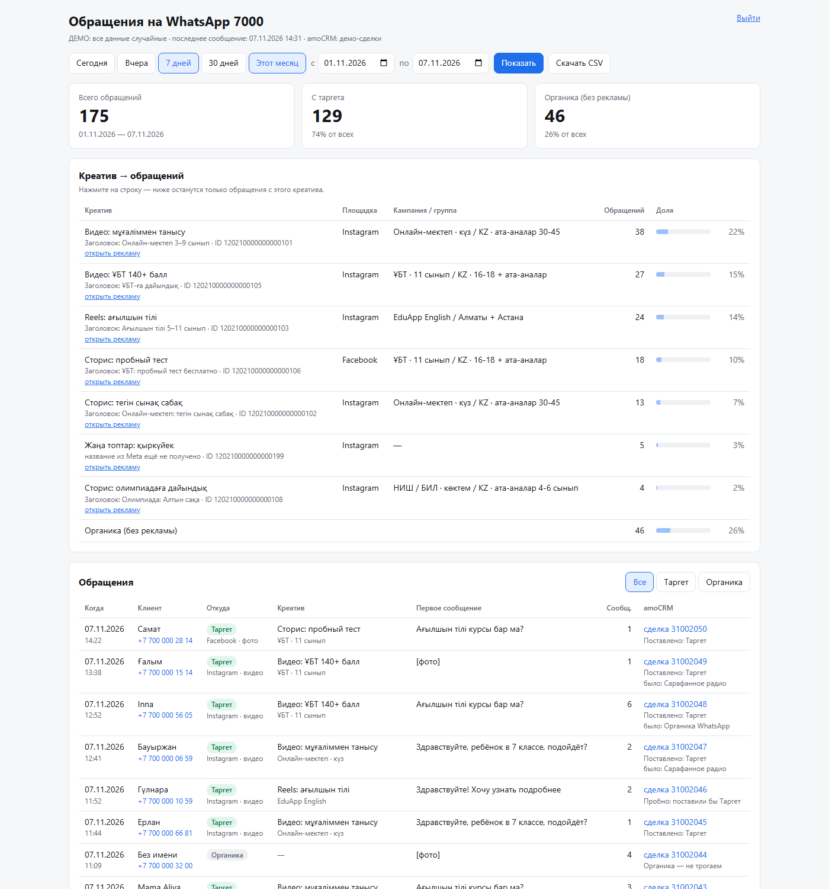

# CRM & Ads Analytics Dashboard

A zero-dependency Python service that receives WhatsApp Cloud API webhooks, attributes every inquiry to the
Meta ad creative that produced it (click-to-WhatsApp `referral`), shows a "creative → inquiries" dashboard,
and writes the attribution back into amoCRM deals (lead source + UTM fields).



> All data in this repository is randomly generated; brand names are anonymized.

## Features

- **Webhook ingestion** for one WhatsApp business number: HMAC-SHA256 signature check (`X-Hub-Signature-256`),
  de-duplication of Meta re-deliveries by `wamid`, other numbers and status updates ignored.
- **Inquiry rules**: a new inquiry is the first message, the first message after N silent days, or a click on a
  *different* ad. Ad vs. organic is decided by the `referral` block of the opening message.
- **Creative names from Meta Marketing API**: targeted `GET /{ad_id}?fields=name,adset{name},campaign{name}` with
  retry back-off and weekly refresh; falls back to the referral headline until a name is known.
- **amoCRM sync** (`off` / `dry-run` / `on`): on the "deal added" webhook, matches the deal to an inquiry by phone,
  sets the lead-source field and `utm_source/medium/campaign/content`. Built-in rate limiter (2 req/s, 1000 req/h),
  repeat-request guard, 429 back-off and a 1-hour stop on 401/403 so the CRM account never gets blocked.
- **Dashboard**: period presets, KPIs (total / ads / organic), creative ranking with platform (Instagram / Facebook)
  and campaign / ad set, filterable inquiry list with the amoCRM outcome, CSV export (Excel-safe, formula-injection
  protected).
- **Aggregated `/api/summary`** for another dashboard: numbers only, key-protected, CORS allow-list.
- **Security**: password login with signed session cookie, login throttling, strict CSP, no `innerHTML`, tokens
  never logged or put in URLs.
- **Demo mode (default)**: in-memory SQLite filled with ~90 days of random but plausible traffic.

## Tech stack

Python 3.10+ standard library only (`http.server`, `sqlite3`, `urllib`, `hmac`) · SQLite (WAL, versioned migrations) ·
vanilla JS + CSS (light/dark) · Docker + Caddy (automatic HTTPS) · `unittest` (65 tests).

## Project structure

```
app.py            HTTP server: Meta & amoCRM webhooks, login, dashboard API, CSV, /api/summary, demo bootstrap
attribution.py    webhook parsing and the "what is an inquiry" rules
meta_ads.py       background fetcher of ad / ad set / campaign names (Graph API)
amocrm.py         amoCRM client (rate limiter, guards) and deal sync queue
report.py         period report, creative summary, aggregated summary, CSV
db.py             SQLite schema + migrations (PRAGMA user_version)
config.py         settings: environment > .env > defaults
demo_data.py      random demo data generator (also a CLI that writes a SQLite file)
samples.py        WhatsApp webhook payload builders (tests, demo, simulator)
tools/simulate.py sends signed fake webhooks to a running non-demo server
web/              dashboard.html, dashboard.js, login.html, style.css
tests/            unit + HTTP tests (no network)
deploy/           server inspection / install scripts
Dockerfile, docker-compose.yml, Caddyfile
```

## How to run (demo mode)

No keys, no network, no `pip install`:

```bash
python app.py
# open http://127.0.0.1:8000
```

`DEMO_MODE` defaults to `1`: the app generates ~2000 random inquiries for the last 90 days in memory, opens the
dashboard without a password and never calls Meta or amoCRM. Options: `DEMO_SEED=42` for reproducible data,
`DEMO_DAYS=30`, `PORT=8080`.

Generate a SQLite file instead (e.g. to run the real mode against it):

```bash
python demo_data.py --db data/demo.db --days 90 --seed 42
```

Tests:

```bash
python -m unittest discover -s tests
```

## Production mode

1. `cp .env.example .env`, set `DEMO_MODE=0`, Meta credentials, dashboard password, amoCRM settings and `DOMAIN`.
2. `docker compose up -d --build` — Caddy obtains the HTTPS certificate.
3. Subscribe the Meta webhook to `https://DOMAIN/webhook` (field `messages`) and the amoCRM "deal added" webhook to
   `https://DOMAIN/amo/webhook?key=AMO_WEBHOOK_KEY`. Start amoCRM in `dry-run`, compare for a day, then switch to `on`.

## Қысқаша (KZ)

Бұл — WhatsApp-қа келген әр өтінімді Meta жарнамасының нақты креативіне байланыстыратын Python сервисі.
Вебхуктарды қабылдайды, қайталанған хабарларды сүзеді, креатив атауларын Meta API-дан алады және нәтижені
amoCRM мәмілелеріне (дереккөз + UTM) жазады. Сыртқы кітапханасыз, тек стандартты Python және SQLite.
Демо режимде `python app.py` командасы кездейсоқ деректермен толтырылған дашбордты ашады.
Репозиторийдегі барлық деректер кездейсоқ жасалған, бренд атаулары өзгертілген.
